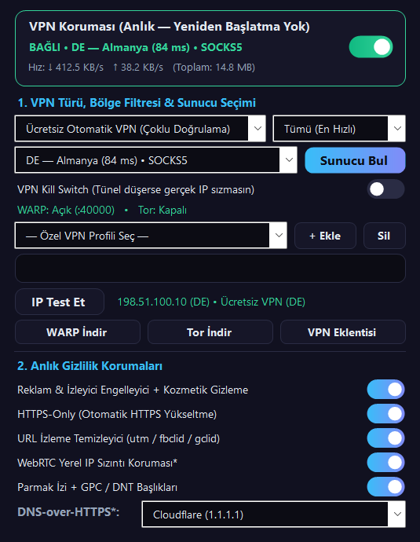
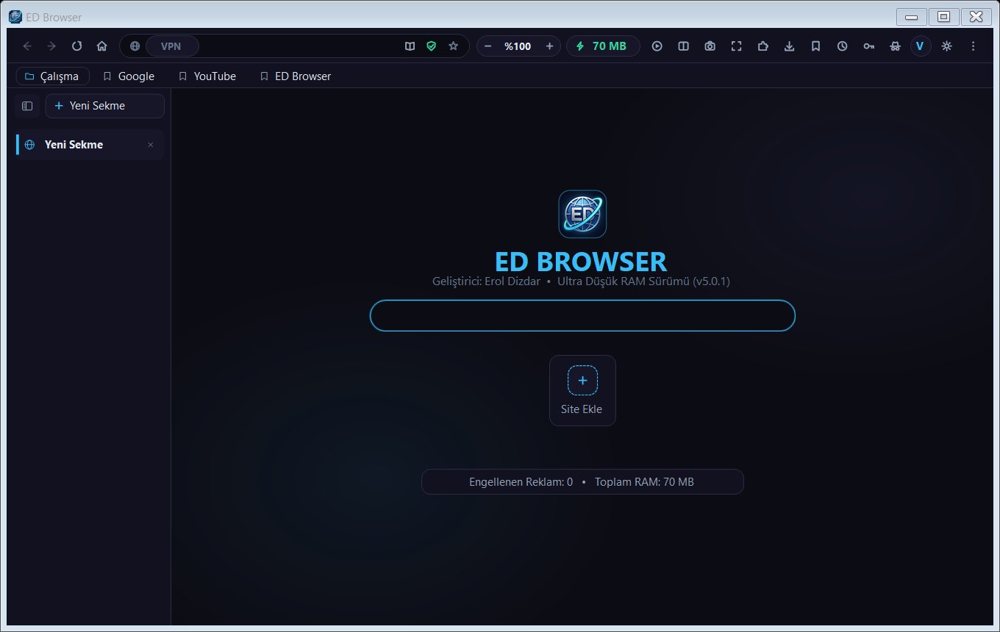
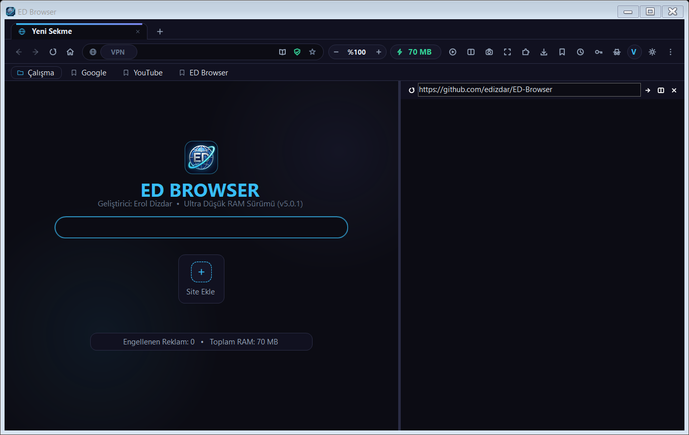
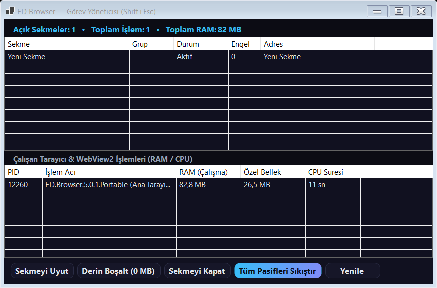
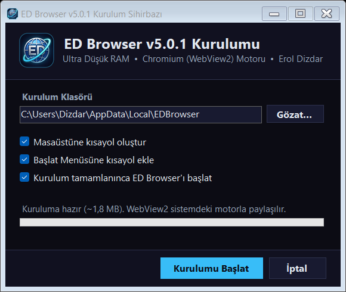
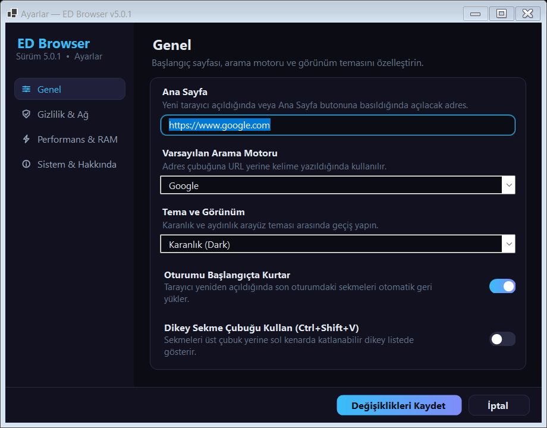
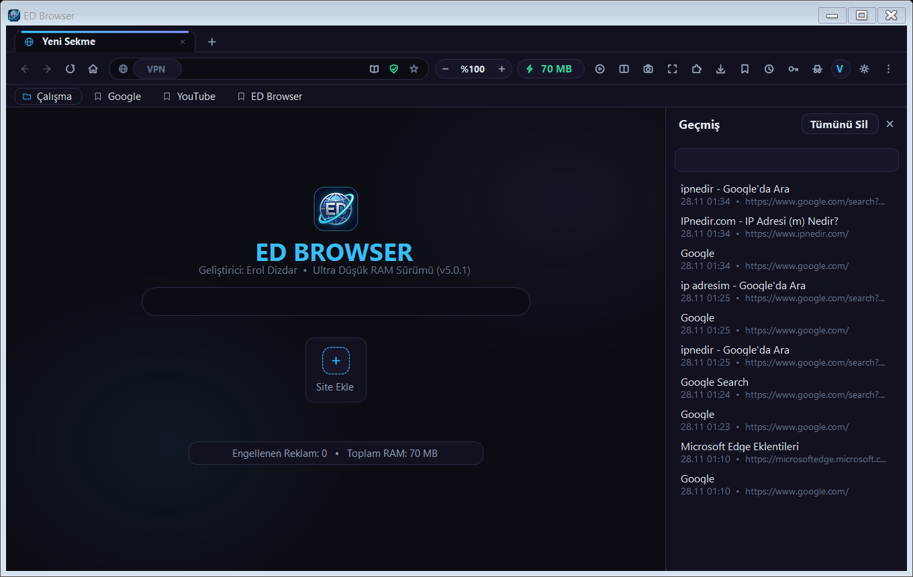

<div align="center">
  
  <h1>ED Browser v5.0.1</h1>
  <p>
    <strong>Reklam yok, izleme yok, telemetri yok, gereksiz RAM tüketimi yok.</strong><br/>
    Chromium (Edge WebView2) motoruyla tam web uyumlu; <strong>Yeniden Başlatmasız Anlık VPN + Kill Switch + Bölge Filtresi</strong>,
    <strong>Bölünmüş Ekran (Split View)</strong>, <strong>Dikey Sekmeler &amp; Sekme Grupları</strong>, <strong>Oturum Kurtarma</strong>,
    <strong>Çoklu Kullanıcı Profili</strong>, <strong>Okuyucu Modu</strong>, <strong>PiP</strong> ve <strong>Görev Yöneticisi</strong> sunan açık kaynak Windows tarayıcısı.
  </p>

  [](https://github.com/edizdar/ED-Browser/releases/latest)
  [-818cf8?style=flat-square)](https://github.com/edizdar/ED-Browser/releases)
  [-34d399?style=flat-square)](PRIVACY.md)
  [](https://www.eroldizdar.tr/p/ed-browser.html)
  [](LICENSE)
</div>

---

## 📥 İndirme Seçenekleri

[GitHub Releases](https://github.com/edizdar/ED-Browser/releases/latest) sayfasından ihtiyacına göre iki sürümden birini indirebilirsin:

| Sürüm | Dosya | Boyut | Açıklama |
| :--- | :--- | :--- | :--- |
| 🛠️ **Kurulum Sürümü (Önerilen)** | `ED.Browser.Setup.5.0.1.exe` | **~3,76 MB** | Kurulum sihirbazı, yeni uygulama simgesi, Masaüstü & Başlat Menüsü kısayolları, Windows Programlar listesi ve `Uninstall.exe` içerir. Profil verileri `%LOCALAPPDATA%\EDBrowser4` altında saklanır. |
| 🎒 **Taşınabilir (Portable) Sürüm** | `ED.Browser.5.0.1.Portable.exe` | **~2,77 MB** | Kurulum gerektirmez, USB veya herhangi bir klasörden çalışır. Tüm veriler yanındaki `EDBrowserData` klasöründe tutulur. |

> **Önkoşul:** Windows 10/11'de yerleşik **Microsoft Edge WebView2** ve **.NET 10 Desktop Runtime (x64)** kullanır.

---

## 📸 Ekran Görüntüleri

### Ana Ekran, Yakınlaştırma & Sürükle-Bırak Yer İmleri Çubuğu
Yeni **"ED"** küre amblemi, adres çubuğu yanında **`VPN`** rozeti, **Okuyucu Modu**, **`− %100 +` Yakınlaştırma**, **`⚡ RAM`**, **Medya Merkezi**, **Bölünmüş Ekran**, **Ekran Görüntüsü**, **Tam Ekran**, **Eklentiler**, **Profil Seçici** ve doğrudan fare yakalamalı sürükle-bırak yer imi çubuğu:


### VPN Kalkanı (`Kill Switch` + Hız) · Modern `⋮` Menü · Chrome Tarzı CDP DevTools
| VPN & Gizlilik Kalkanı | Modern `⋮` Menüsü (Otomatik Kapanan) | Chrome Tarzı CDP DevTools |
| :---: | :---: | :---: |
|  |  |  |

### Dikey Sekmeler · Bölünmüş Ekran (Split View) · Görev Yöneticisi (`Shift+Esc`)
| Dikey Sekmeler (`Ctrl+Shift+V`) | Bölünmüş Ekran (`Ctrl+Shift+X`) | Görev Yöneticisi (`Shift+Esc`) |
| :---: | :---: | :---: |
|  |  |  |

### Eklenti Mağazası · Kurulum Sihirbazı · Tarama Verilerini Temizle
| Chromium Eklenti Mağazası (Chrome Web Store + Edge Add-ons + CRX) | Windows Kurulum Sihirbazı | Tarama Verilerini Temizle |
| :---: | :---: | :---: |
|  |  |  |

### Modern 2 Sütunlu Ayarlar, Geçmiş & Yer İmi Düzenleme
| Ayarlar — Genel | Ayarlar — Gizlilik, VPN & Ağ | Geçmiş Paneli |
| :---: | :---: | :---: |
|  |  |  |

---

## ⚡ v3.1.8 (Electron) vs v5.0.1 (WinForms + WebView2) Karşılaştırması

| Ölçüt | ED Browser v3.1.8 (Electron) | ED Browser v5.0.1 (WinForms + WebView2) |
| :--- | :--- | :--- |
| **Taşınabilir `.exe` Boyutu** | 72,67 MB | **~2,77 MB** (**%96,2 daha küçük**) |
| **Kurulum `.exe` Boyutu** | 73,00 MB | **~3,76 MB** (**%94,8 daha küçük**) |
| **Çalıştırılınca Açılan Disk Alanı** | 251,72 MB | **~2,8–3,8 MB** (sistem WebView2 paylaşılır) |
| **Arayüz Motoru** | Ekstra Chromium Renderer süreci | **Saf yerel WinForms GDI+** (0 ekstra renderer) |
| **Sekme & Üretkenlik** | Temel yatay sekme | **Oturum Kurtarma + Dikey Sekmeler + Renkli Sekme Grupları + Bölünmüş Ekran (Split View) + Canlı Omnibox Otomatik Tamamlama** |
| **Pasif Sekme Bellek Yönetimi** | Yalnızca JS zamanlayıcı kısma | **`MemoryUsageTargetLevel.Low` + `TrySuspendAsync()` + Derin Boşaltma (`0 MB`) + Görev Yöneticisi (`Shift+Esc`)** |
| **VPN & Gizlilik Kalkanı** | Yalnızca temel proxy/DoH | **Yeniden Başlatmasız Anlık `LocalVpnRouterService` + Bölge Filtresi + Canlı `KB/s` Hız + Kill Switch + WARP/Tor/Özel Profil + HTTPS-Only + WebRTC + Multi-DoH ([PRIVACY.md](PRIVACY.md))** |
| **Reklam & İzleme Engelleme** | 45 sabit alan adı | **Dinamik güncellenen Peter Lowe/EasyList kuralları + Kozmetik CSS gizleme + Site bazlı duraklatma + URL temizleyici** |
| **Geliştirici Araçları** | Kısıtlı harici pencere | **CDP Tabanlı Gömülü DevTools (Öğeler, Konsol REPL, Ağ, Depo, Kaynak, Öğe Seçici, Cihaz Emülasyonu)** |
| **Eklenti Mağazası** | Yok | **Chrome Web Store + Microsoft Edge Add-ons + `.crx`/`.zip`/Klasör + Araç Çubuğu Popup İkonları** |
| **Okuma, Medya & Profiller** | Yok | **Okuyucu Modu (`Ctrl+Alt+R`) + Medya Merkezi & PiP + Çoklu İzole Kullanıcı Profilleri + Site Favicon Önbelleği** |
| **Şifre Kasası Güvenliği** | Sabit anahtarlı AES-256-CBC | **AES-256-GCM + Windows DPAPI** (kullanıcıya özel anahtar) |
| **Güncelleme** | Yok | **Uygulama içi otomatik indir & uygula güncelleyicisi** |

---

## ✨ Öne Çıkan Özellikler

- **Tek Tıkla Anlık VPN, Bölge Filtresi, Canlı Hız & Kill Switch (`VPN` Rozeti):**
  - Tarayıcıyı **yeniden başlatmadan**, yerleşik [LocalVpnRouterService.cs](Services/LocalVpnRouterService.cs) üzerinden VPN'i tek anahtarla **Açık / Kapalı** yapma ve sunucular arasında anlık geçiş.
  - **`Sunucu Bul` + Bölge Filtresi (`Tümü / EU / US / AS`):** GeoNode & ProxyScrape rölelerini `google.com/generate_204` + `cloudflare.com/cdn-cgi/trace` ikili HTTPS doğrulamasından geçirir, bozuk/kısıtlı düğümleri eler ve otomatik yedek sunucu geçişi (failover) yapar.
  - **Canlı Hız & Kill Switch:** Panelde `↓ / ↑ KB/s` aktarım hızı gösterir; **VPN Kill Switch** açıkken tünel düşerse gerçek IP sızmasını `503` ile keser.
  - Ayrıca tek tıkla **Cloudflare WARP (`127.0.0.1:40000`)**, **Tor (`127.0.0.1:9050` / `9150`)**, **Chrome Web Store VPN eklentileri** ve özel SOCKS5/HTTPS profilleri.
- **Üretkenlik Suite'i (Oturum Kurtarma, Dikey Sekmeler, Sekme Grupları, Split View & Autocomplete):**
  - Açılışta son sekmeleri pasif `0 MB` bellek modunda geri getiren **Oturum Kurtarma**, sol kenarda katlanabilir **Dikey Sekmeler (`Ctrl+Shift+V`)**, renkli **Sekme Grupları**, yan yana **Bölünmüş Ekran (`Ctrl+Shift+X`)** ve odak çalmayan canlı **Omnibox Otomatik Tamamlama**.
- **Dinamik Reklam Engelleyici, Kozmetik CSS & Site İstisnaları:**
  - `Ayarlar → Gizlilik & Ağ` içinden güncellenebilen Peter Lowe / EasyList alan adı filtreleri, boş reklam kutularını gizleyen kozmetik CSS ve adres çubuğundaki kilit ikonundan site bazlı **Reklam Engelleyici Duraklatma / HTTPS-Only İstisnası**.
- **Çoklu Profil, Okuyucu Modu (`Ctrl+Alt+R`), Medya Merkezi, PiP & Görev Yöneticisi (`Shift+Esc`):**
  - Ayrı çerez, şifre, yer imi ve eklenti verisine sahip **Çoklu Kullanıcı Profilleri (`--profile`)**, dikkat dağıtmayan **Okuyucu Modu**, arka plan medya duraklatma + **Resim İçinde Resim (PiP)**, sekme/işlem RAM & CPU izleyen **Görev Yöneticisi** ve gerçek site **Favicon Önbelleği**.
- **Gerçek Chrome Tarzı CDP DevTools (`F12`) & Chromium Eklenti Desteği (`Ctrl+Shift+E`):**
  - Öğeler (canlı CSS editörü), Konsol REPL, Ağ, Depo, Kaynak, Öğe Seçici (`Ctrl+Shift+C`), Cihaz Emülasyonu; Chrome Web Store / Edge Add-ons tek tık **`ED Browser'a Ekle`** ve araç çubuğundan eklenti popup pencereleri.

---

## ⌨️ Klavye Kısayolları

| Kısayol | İşlev |
| :--- | :--- |
| `Ctrl+T` / `Ctrl+W` / `Ctrl+Shift+T` | Yeni sekme / Kapat / Kapalı sekmeyi yeniden aç |
| `Ctrl+N` / `Ctrl+Shift+P` | Yeni pencere / Yeni gizli pencere |
| `Ctrl+1` … `Ctrl+9` | İlgili sekmeye geç |
| `Ctrl+Shift+V` / `Ctrl+Shift+X` | Dikey Sekmeleri aç/kapat / Bölünmüş Ekran (Split View) |
| `Ctrl+Alt+R` | Okuyucu Modu (Reader View) |
| `Shift+Esc` | Tarayıcı Görev Yöneticisi (RAM / CPU & Uyutma) |
| `Ctrl+L` / `F5` / `Ctrl+R` | Adres çubuğuna odaklan / Yenile |
| `Alt+←` / `Alt+→` | Geri / İleri git |
| `Ctrl+D` / `Ctrl+Shift+O` / `Ctrl+Shift+B` | Yer imi ekle / Panel / Yer imi çubuğu |
| `Ctrl+H` / `Ctrl+Shift+J` / `Ctrl+Shift+E` | Geçmiş / İndirilenler / Eklentiler |
| `Ctrl+Shift+L` | Opera/Yandex tarzı Sol Kenar Çubuğunu aç / gizle |
| `Ctrl+F` / `Ctrl+S` / `Ctrl+P` / `Ctrl+U` | Sayfada ara / Farklı kaydet / Yazdır / Kaynak kod |
| `Ctrl+Shift+S` / `Ctrl+Shift+Del` | Ekran görüntüsü / Tarama verilerini temizle |
| `Ctrl++` / `Ctrl+-` / `Ctrl+0` | Yakınlaştır / Uzaklaştır / %100 sıfırla |
| `F11` / `ESC` | Tam ekran aç / çık |
| `F12` / `Ctrl+Shift+I` / `Ctrl+Shift+C` | Geliştirici araçları / Sayfadan öğe seçici |

---

## 🛠️ Kaynak Koddan Derleme

Gereksinimler: **.NET 10 SDK** (Windows x64)

```powershell
# 1. Taşınabilir tek dosya .exe derle
dotnet publish EDBrowser.csproj -c Release -r win-x64 --no-self-contained -o publish

# 2. Kurulum Sihirbazı (.exe) derle (taşınabilir sürümü içine gömer)
dotnet publish Installer\EDBrowser.Setup.csproj -c Release -r win-x64 --no-self-contained -o Installer\publish
```

---

*ED Browser — Geliştirici: [Erol Dizdar](https://www.eroldizdar.tr/p/ed-browser.html)*
