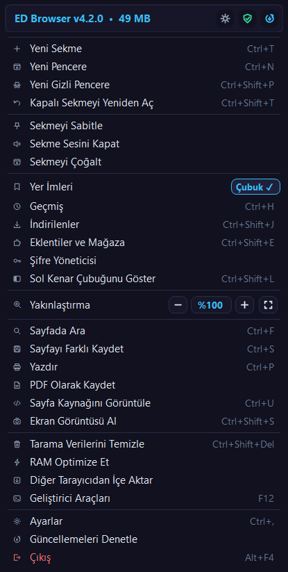
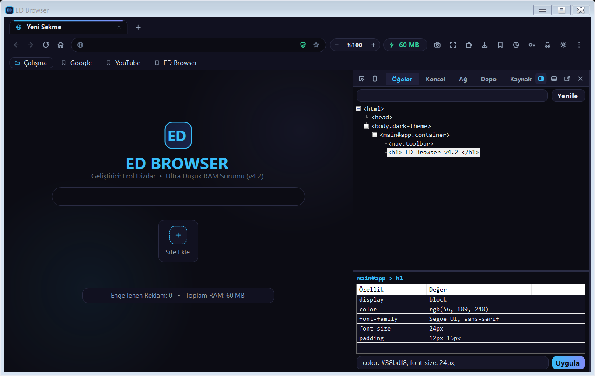
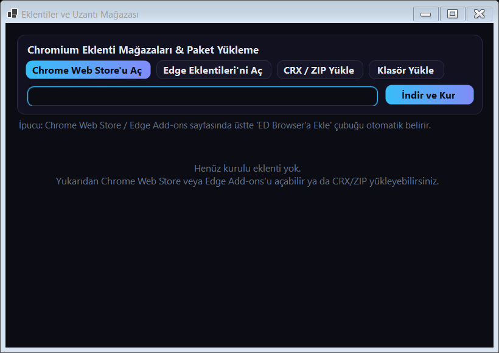
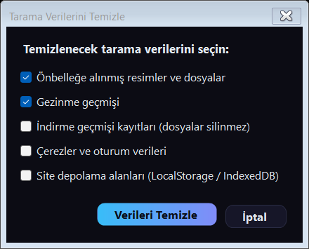
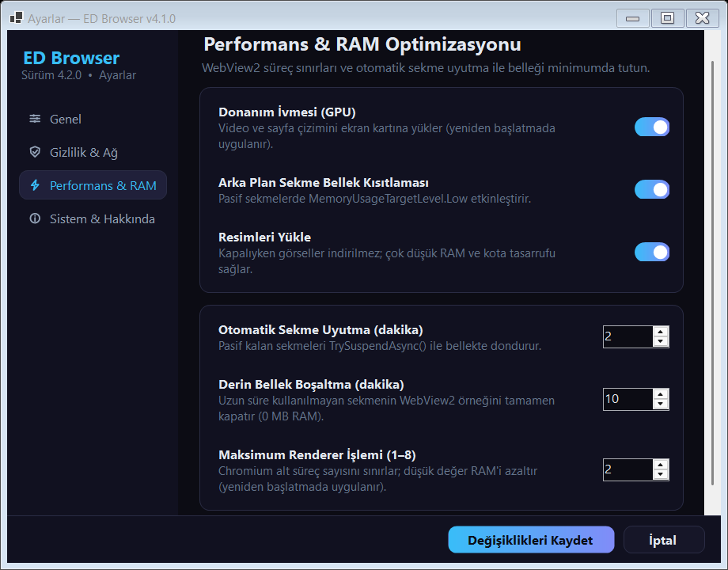
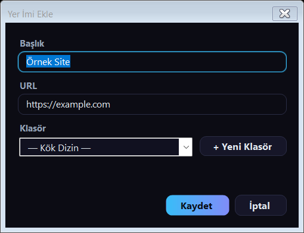

# 🌐 ED Browser v4.2.0

> Reklam yok, izleme yok, gereksiz RAM tüketimi yok. **Chromium (Edge WebView2)** motoruyla tam web uyumlu, **Chrome Web Store & Microsoft Edge Add-ons** eklenti desteği sunan, yerel **WinForms GDI+** arayüzü sayesinde ultra hafif ve tamamen açık kaynak Windows masaüstü tarayıcısı.

[](https://github.com/edizdar/ED-Browser/releases/latest)
[-818cf8?style=flat-square)](https://github.com/edizdar/ED-Browser/releases)
[](LICENSE)

---

## 📥 İndirme Seçenekleri

[Releases](https://github.com/edizdar/ED-Browser/releases/latest) sayfasından ihtiyacına göre iki sürümden birini indirebilirsin:

| Sürüm | Dosya | Boyut | Açıklama |
| :--- | :--- | :--- | :--- |
| 🛠️ **Kurulum Sürümü (Önerilen)** | `ED.Browser.Setup.4.2.0.exe` | **~2,01 MB** | Kurulum sihirbazı, Masaüstü & Başlat Menüsü kısayolları, Windows Programlar listesi ve `Uninstall.exe` içerir. Profil verileri `%LOCALAPPDATA%\EDBrowser4` altında saklanır. |
| 🎒 **Taşınabilir (Portable) Sürüm** | `ED.Browser.4.2.0.Portable.exe` | **~1,79 MB** | Kurulum gerektirmez, USB veya herhangi bir klasörden çalışır. Tüm veriler yanındaki `EDBrowserData` klasöründe tutulur. |

> **Önkoşul:** Windows 10/11'de yerleşik **Microsoft Edge WebView2** ve **.NET 10 Desktop Runtime (x64)** kullanır.

---

## 📸 Ekran Görüntüleri

### Ana Ekran, Yakınlaştırma & Sürükle-Bırak Yer İmleri Çubuğu
Adres çubuğu yanında canlı **`− %100 +` Yakınlaştırma**, **`⚡ RAM`**, **Ekran Görüntüsü**, **Tam Ekran**, **Eklentiler**, özelleştirilebilir **`+ Site Ekle`** yeni sekme sayfası ve doğrudan fare yakalamalı sürükle-bırak yer imi çubuğu:


### Modern `⋮` Uygulama Menüsü & Chrome Tarzı Sabitlenmiş Geliştirici Araçları
| Modern `⋮` Menüsü (Otomatik Kapanan) | Chrome Tarzı CDP DevTools (Sağ / Alt / Ayrı Pencere) |
| :---: | :---: |
|  |  |

### Eklenti Mağazası & Tarama Verilerini Temizle
| Chromium Eklenti Mağazası (Chrome Web Store + Edge Add-ons + CRX) | Tarama Verilerini Temizle |
| :---: | :---: |
|  |  |

### Geçmiş Paneli & Kurulum Sihirbazı
| Geçmiş Paneli (Arama & Tekil Silme) | Windows Kurulum Sihirbazı |
| :---: | :---: |
|  |  |

### Modern 2 Sütunlu Ayarlar & Yer İmi Düzenleme
| Genel | Gizlilik & Ağ |
| :---: | :---: |
|  |  |
| **Performans & RAM Optimizasyonu** | **Sistem, Güncelleme & Yer İmi Klasörü** |
|  |  |

---

## ⚡ v3.1.8 (Electron) vs v4.2.0 (WinForms + WebView2) Karşılaştırması

| Ölçüt | ED Browser v3.1.8 (Electron) | ED Browser v4.2.0 (WinForms + WebView2) |
| :--- | :--- | :--- |
| **Taşınabilir `.exe` Boyutu** | 72,67 MB | **1,79 MB** (**%97,5 daha küçük**) |
| **Kurulum `.exe` Boyutu** | 73,00 MB | **2,01 MB** (**%97,2 daha küçük**) |
| **Çalıştırılınca Açılan Disk Alanı** | 251,72 MB | **~1,8–2,0 MB** (sistem WebView2 paylaşılır) |
| **Arayüz Motoru** | Ekstra Chromium Renderer süreci | **Saf yerel WinForms GDI+** (0 ekstra renderer) |
| **Pasif Sekme Bellek Yönetimi** | Yalnızca JS zamanlayıcı kısma | **`MemoryUsageTargetLevel.Low` + `TrySuspendAsync()` + Derin Boşaltma (`0 MB`)** |
| **Geliştirici Araçları** | Kısıtlı harici pencere | **CDP Tabanlı Gömülü DevTools (Öğeler, Konsol REPL, Ağ, Depo, Kaynak, Öğe Seçici, Cihaz Emülasyonu)** |
| **Eklenti Mağazası** | Yok | **Chrome Web Store + Microsoft Edge Add-ons + `.crx`/`.zip`/Klasör** |
| **Şifre Kasası Güvenliği** | Sabit anahtarlı AES-256-CBC | **AES-256-GCM + Windows DPAPI** (kullanıcıya özel anahtar) |
| **Reklam & İzleyici Engelleyici** | 45 ağ | **150+ reklam, takipçi ve telemetri ağı** |
| **Güncelleme Bildirimi** | Yok | **Açılışta + Menü/Ayarlardan tek tıkla GitHub kontrolü** |

---

## ✨ Öne Çıkan Özellikler

- **Agresif RAM Optimizasyonu:** Arka plan sekmelerinde düşük bellek modu, otomatik `TrySuspendAsync()` sekme uyutma (`💤`), derin bellek boşaltma (`❄️`) ve araç çubuğundan canlı `⚡ XX MB` ile tek tıkla temizleme.
- **Gerçek Chrome Tarzı Geliştirici Araçları (`F12` / `Ctrl+Shift+I` / Sağ Tık → İncele):**
  - Sağa veya alta sabitlenebilen gerçek CDP tabanlı panel: **Öğeler** (canlı stil editörü), **Konsol + JS REPL**, **Ağ**, **Depo** (Çerezler / LocalStorage / SessionStorage), **Kaynak**, **Sayfadan Öğe Seçici (`Ctrl+Shift+C`)** ve **Mobil/Tablet Cihaz Emülasyonu**; dilersen tek tıkla Tam Chromium DevTools penceresi.
- **Chromium Eklenti Desteği (`Ctrl+Shift+E`):**
  - **Chrome Web Store** ve **Microsoft Edge Add-ons** eklentilerini URL/ID ile veya mağaza sayfasındayken üstte açılan tek tık **`ED Browser'a Ekle`** çubuğuyla indirip CRX3 paketini açarak doğrudan WebView2 profiline yükler; `.crx`/`.zip` ve açık klasör yüklemeyi destekler.
- **Doğrudan Araç Çubuğu & Modern `⋮` Menü (`Alt + Sol Kenar Çubuğu`):**
  - Adres çubuğu yanında **`− %100 +` Yakınlaştırma**, **Ekran Görüntüsü**, **Tam Ekran**, **Eklentiler** ve isteğe bağlı Opera/Yandex tarzı **Sol Kenar Çubuğu (`Ctrl+Shift+L`)**.
  - Web sayfasına tıklandığında anında kapanan DWM yuvarlatılmış **`⋮` Uygulama Menüsü**: Kapalı Sekmeyi Yeniden Aç (`Ctrl+Shift+T`), Sekme Sabitleme/Ses Kapatma, PDF/Sayfa Kaydetme, Sayfa Kaynağı (`Ctrl+U`), Tarama Verilerini Temizle (`Ctrl+Shift+Del`), Hızlı Tema/Reklam Engelleyici.
- **Sorunsuz Sürükle-Bırak Yer İmleri:**
  - Yer imi çubuğunda doğrudan fare yakalamalı sürükleme: cam hayalet kapsül, parlak ekleme çizgisi ve klasörlerin ortasına bırakınca otomatik klasör içi taşıma; taşan öğeler için `»` menüsü.

---

## ⌨️ Klavye Kısayolları

| Kısayol | İşlev |
| :--- | :--- |
| `Ctrl+T` / `Ctrl+W` / `Ctrl+Shift+T` | Yeni sekme / Kapat / Kapalı sekmeyi yeniden aç |
| `Ctrl+N` / `Ctrl+Shift+P` | Yeni pencere / Yeni gizli pencere |
| `Ctrl+1` … `Ctrl+9` | İlgili sekmeye geç |
| `Ctrl+L` / `F5` / `Ctrl+R` | Adres çubuğuna odaklan / Yenile |
| `Alt+←` / `Alt+→` | Geri / İleri git |
| `Ctrl+D` / `Ctrl+Shift+O` / `Ctrl+Shift+B` | Yer imi ekle / Panel / Yer imi çubuğu |
| `Ctrl+H` / `Ctrl+Shift+J` / `Ctrl+Shift+E` | Geçmiş / İndirilenler / Eklentiler |
| `Ctrl+Shift+L` | Opera/Yandex tarzı Sol Kenar Çubuğunu aç / gizle |
| `Ctrl+F` / `Ctrl+S` / `Ctrl+P` / `Ctrl+U` | Sayfada ara / Farklı kaydet / Yazdır / Kaynak kod |
| `Ctrl+Shift+S` / `Ctrl+Shift+Del` | Ekran görüntüsü / Tarama verilerini temizle |
| `Ctrl++` / `Ctrl+-` / `Ctrl+0` | Yakınlaştır / Uzaklaştır / %100 sıfırla |
| `F11` / `ESC` | Tam ekran aç / çık |
| `F12` / `Ctrl+Shift+I` / `Ctrl+Shift+C` | Geliştirici araçları / Sayfadan öğe seçici |

---

## 🛠️ Kaynak Koddan Derleme

Gereksinimler: **.NET 10 SDK** (Windows x64)

```powershell
# 1. Taşınabilir tek dosya .exe derle
dotnet publish EDBrowser.csproj -c Release -r win-x64 --no-self-contained -o publish

# 2. Kurulum Sihirbazı (.exe) derle (taşınabilir sürümü içine gömer)
dotnet publish Installer\EDBrowser.Setup.csproj -c Release -r win-x64 --no-self-contained -o publish
```

---

*ED Browser — Geliştirici: [Erol Dizdar](https://eroldizdar.tr)*
