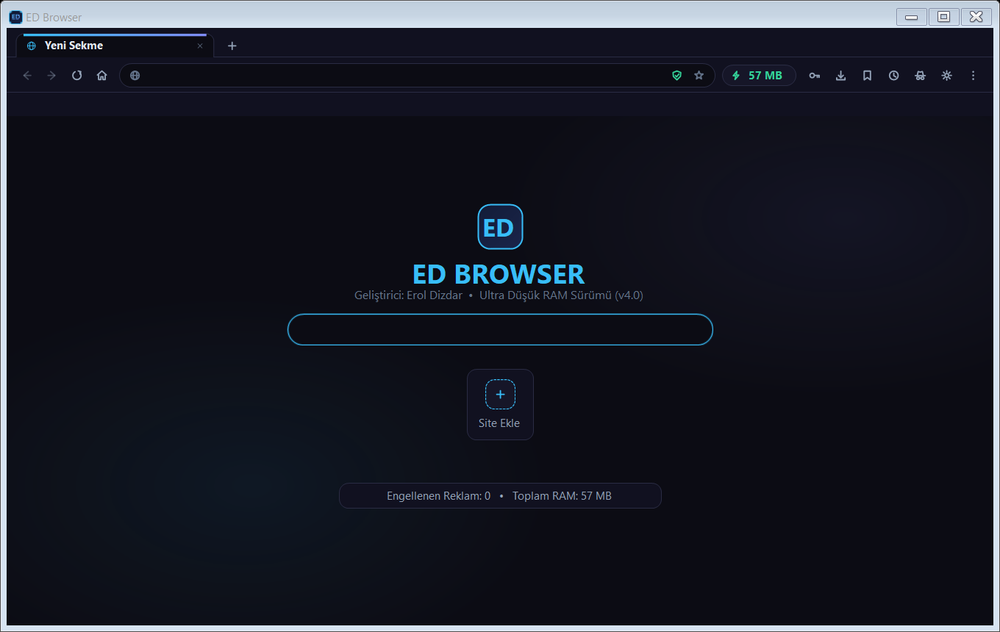
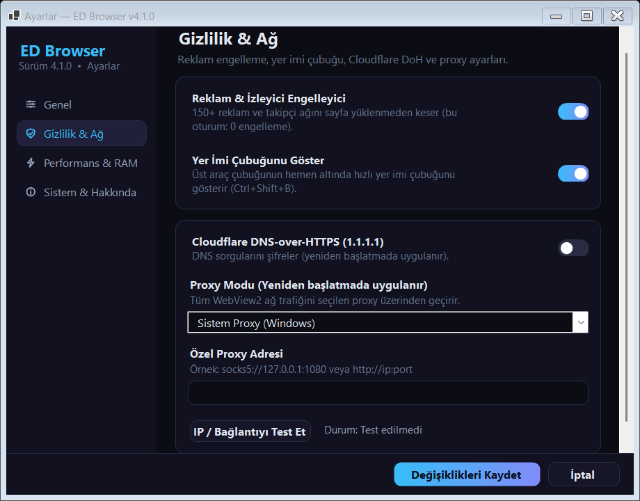
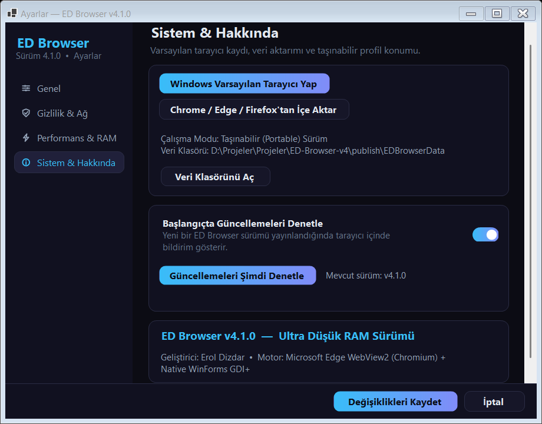

# 🌐 ED Browser v4.1.0

> Reklam yok, izleme yok, gereksiz RAM tüketimi yok. **Chromium (Edge WebView2)** motoruyla tam web uyumlu, yerel **WinForms GDI+** arayüzü sayesinde ultra hafif ve tamamen açık kaynak Windows masaüstü tarayıcısı.

[](https://github.com/edizdar/ED-Browser/releases/latest)
[-818cf8?style=flat-square)](https://github.com/edizdar/ED-Browser/releases)
[](LICENSE)

---

## 📥 İndirme Seçenekleri

[Releases](https://github.com/edizdar/ED-Browser/releases/latest) sayfasından ihtiyacına göre iki sürümden birini indirebilirsin:

| Sürüm | Dosya | Boyut | Açıklama |
| :--- | :--- | :--- | :--- |
| 🛠️ **Kurulum Sürümü (Önerilen)** | `ED.Browser.Setup.4.1.0.exe` | **~1,84 MB** | Kurulum sihirbazı, Masaüstü & Başlat Menüsü kısayolları, Windows Programlar listesi ve `Uninstall.exe` içerir. Profil verileri `%LOCALAPPDATA%\EDBrowser4` altında saklanır. |
| 🎒 **Taşınabilir (Portable) Sürüm** | `ED.Browser.4.1.0.Portable.exe` | **~1,61 MB** | Kurulum gerektirmez, USB veya herhangi bir klasörden çalışır. Tüm veriler yanındaki `EDBrowserData` klasöründe tutulur. |

> **Önkoşul:** Windows 10/11'de yerleşik **Microsoft Edge WebView2** ve **.NET 10 Desktop Runtime (x64)** kullanır.

---

## 📸 Ekran Görüntüleri

### Ana Ekran & Özelleştirilebilir Yeni Sekme
Kullanıcı tarafından yönetilen site kısayolları (`+ Site Ekle`), hap (pill) adres çubuğu, canlı `⚡ RAM` göstergesi ve vektörel karanlık arayüz:



### Geçmiş Paneli (Arama & Tekil Silme)
Anlık arama kutusu, satır üzeri `×` butonu ile tekil kayıt silme ve sağ tık menüsü (`Bu Sitenin Tüm Geçmişini Sil` dahil):


### Modern 2 Sütunlu Ayarlar
| Genel | Gizlilik & Ağ |
| :---: | :---: |
|  |  |
| **Performans & RAM Optimizasyonu** | **Sistem, Güncelleme & Hakkında** |
|  |  |

### Yer İmi Ekleme & Kurulum Sihirbazı
| Yer İmi Ekle / Klasör Oluştur | Windows Kurulum Sihirbazı |
| :---: | :---: |
|  |  |

---

## ⚡ v3.1.8 (Electron) vs v4.1.0 (WinForms + WebView2) Karşılaştırması

| Ölçüt | ED Browser v3.1.8 (Electron) | ED Browser v4.1.0 (WinForms + WebView2) |
| :--- | :--- | :--- |
| **Taşınabilir `.exe` Boyutu** | 72,67 MB | **1,61 MB** (**%97,8 daha küçük**) |
| **Kurulum `.exe` Boyutu** | 73,00 MB | **1,84 MB** (**%97,5 daha küçük**) |
| **Çalıştırılınca Açılan Disk Alanı** | 251,72 MB | **~1,6–1,8 MB** (sistem WebView2 paylaşılır) |
| **Arayüz Motoru** | Ekstra Chromium Renderer süreci | **Saf yerel WinForms GDI+** (0 ekstra renderer) |
| **Pasif Sekme Bellek Yönetimi** | Yalnızca JS zamanlayıcı kısma | **`MemoryUsageTargetLevel.Low` + `TrySuspendAsync()` + Derin Boşaltma (`0 MB`)** |
| **Şifre Kasası Güvenliği** | Sabit anahtarlı AES-256-CBC | **AES-256-GCM + Windows DPAPI** (kullanıcıya özel anahtar) |
| **Reklam & İzleyici Engelleyici** | 45 ağ | **150+ reklam, takipçi ve telemetri ağı** |
| **Güncelleme Bildirimi** | Yok | **Açılışta + Ayarlardan tek tıkla GitHub kontrolü** |

---

## ✨ Öne Çıkan Özellikler

- **Agresif RAM Optimizasyonu:**
  - Arka planda kalan sekmeler önce düşük bellek moduna geçer, belirlenen süre sonunda `TrySuspendAsync()` ile uyutulur (`💤`), uzun süre kullanılmazsa derin boşaltma (`❄️`) ile tamamen sıfırlanır.
  - Araç çubuğundaki **`⚡ XX MB`** butonuna tıklayarak tüm pasif sekmeleri anında uyutup çalışma kümesini (working set) sıkıştırabilirsin.
- **Chrome Gibi Geliştirici Araçları (`F12` / `Ctrl+Shift+I` / Sağ Tık → İncele):**
  - Tarayıcının sağ tarafına sabitlenmiş (docked), sürüklenebilir ayırıcılı DevTools paneli; kısayola tekrar basınca kapanır.
- **Yerleşik Reklam & İzleyici Engelleyici:**
  - 150'den fazla reklam ve analitik ağı sayfa yüklenmeden engellenir; adres çubuğundaki kalkan simgesinden anlık açılıp kapatılabilir.
- **AES-256-GCM + Windows DPAPI Yerel Şifre Yöneticisi:**
  - Hiçbir veri buluta gitmez. Anahtar Windows DPAPI ile o kullanıcı hesabına bağlı saklanır. Formlarda otomatik **Doldur / Kaydet** çubuğu ve Chrome/Edge CSV içe aktarımı sunar.
- **Kullanıcı Kontrollü Yeni Sekme & Yer İmleri:**
  - Yeni sekmede sabit site kalabalığı yoktur; **`+ Site Ekle`** ile kendi kısayollarını ekleyebilirsin.
  - Yer imi çubuğunda fareyle **basılı tutup sürükleyerek** sıralama yapabilir veya bir klasörün içine bırakabilirsin. Klasör menüleri fare çıkınca otomatik kapanır.
- **Proxy & Cloudflare DNS-over-HTTPS:**
  - Doğrudan, Sistem Proxy, Özel HTTP/SOCKS5 veya Tor (`127.0.0.1:9050`) + Cloudflare DoH (`1.1.1.1`) ve dahili IP test aracı.
- **Ekran Görüntüsü (`Ctrl+Shift+S`), Gizli Mod (`Ctrl+Shift+P`), İndirme Yöneticisi (`Ctrl+Shift+J`), Sayfada Ara (`Ctrl+F`)** ve **Windows Varsayılan Tarayıcı** kaydı.

---

## ⌨️ Klavye Kısayolları

| Kısayol | İşlev |
| :--- | :--- |
| `Ctrl+T` / `Ctrl+W` | Yeni sekme aç / Aktif sekmeyi kapat |
| `Ctrl+1` … `Ctrl+9` | İlgili sekmeye geç |
| `Ctrl+L` | Adres çubuğuna odaklan |
| `F5` / `Ctrl+R` | Sayfayı yenile |
| `Alt+←` / `Alt+→` | Geri / İleri git |
| `Ctrl+D` | Yer imi ekle / düzenle / kaldır |
| `Ctrl+Shift+B` | Yer imi çubuğunu göster / gizle |
| `Ctrl+F` | Sayfada ara |
| `Ctrl+P` | Sayfayı yazdır |
| `Ctrl+Shift+J` | İndirilenler paneli |
| `Ctrl+Shift+S` | Ekran görüntüsü al (Tüm sayfa / Alan seç) |
| `Ctrl+Shift+P` | Gizli mod penceresi aç |
| `Ctrl++` / `Ctrl+-` / `Ctrl+0` | Yakınlaştır / Uzaklaştır / %100 sıfırla |
| `F11` / `ESC` | Tam ekran aç / çık |
| `F12` / `Ctrl+Shift+I` | Geliştirici araçlarını aç / kapat |

---

## 🛠️ Kaynak Koddan Derleme

Gereksinimler: **.NET 10 SDK** (Windows x64)

```powershell
# 1. Taşınabilir tek dosya .exe derle
dotnet publish EDBrowser.csproj -c Release -r win-x64 --self-contained false -p:PublishSingleFile=true -p:IncludeNativeLibrariesForSelfExtract=true -o publish

# 2. Kurulum Sihirbazı (.exe) derle (taşınabilir sürümü içine gömer)
dotnet publish Installer\EDBrowser.Setup.csproj -c Release -r win-x64 --self-contained false -p:PublishSingleFile=true -o publish
```

---

*ED Browser — Geliştirici: [Erol Dizdar](https://eroldizdar.tr)*
